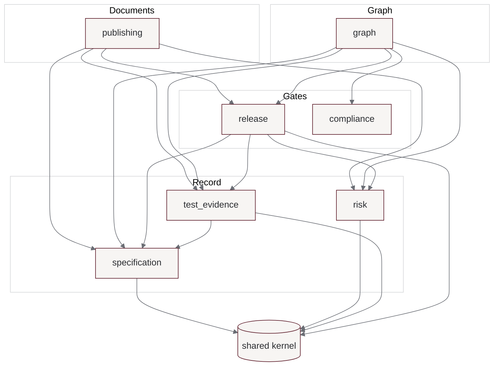

# System Architecture

RDM audits the record of regulated software. It reads a spec as Gherkin
(each scenario tagged with an id a requirement), takes the evidence of each
requirement from Allure test runs, checks documents against the checklists of
the standards that apply, decides whether a release may go ahead, renders
regulatory documents, and builds it all into a read-only graph that people
and agents query. It never authors the spec (ADR 0002).

This document holds **design only**: RDM's own requirements and user needs
are its spec, written the Löyly way in `.pi/` (a slice of `.pi/plan/` per
bounded context), read like any project's.

## Context map

Each bounded context in its part; an arrow is a dependency in the code (the
context imports the one it points to), downwards only, as the dependency
rule requires (below).



## The four parts

| Part | Responsibility | Writes to the record? |
|------|----------------|-----------------------|
| **Record** | read the record: the spec (Gherkin), the risk register, validation records, checklists, test results, git | scaffolding only (`init`, `adopt`); every other change is a reviewed commit |
| **Gates** | pass/block decisions on the record | no |
| **Graph** | the knowledge graph: the record as RDF, queried and validated; agents read it over MCP (`rdm graph mcp`) | no — rebuilt from the record, never edited |
| **Documents** | regulatory documents rendered from the record | no |

Only people and agents change the record, and only through a reviewed pull
request; the merge is the approval. Nothing RDM derives (graph, matrix,
documents, evidence bundle) is edited by hand or fed back into the record.

## System context

Who uses RDM: a regulatory author renders documents and checks them against
checklists; a team runs the gates in CI on every change; an agent reads the
record through the graph's MCP server; a reviewer reads the verification
report and the evidence bundle. RDM runs as the `rdm` command, as a pytest
plugin inside a project's acceptance run, and as reusable CI (a GitHub
workflow and actions). It depends on git, on Allure results written by the
project's test runner, and, to render PDFs, on Pandoc and Typst.

## Bounded contexts (one design document each), by part

A bounded context is drawn where the language changes, not where the workflow
does (`CONTEXT.md`): the stages of a requirement's life (written, verified,
released) are not contexts. The code of each context is in the frontmatter
(`code`).

| Part | Context | Design document | Its language | Package |
|------|---------|-----------------|--------------|---------|
| Record | `specification` (core) | `design/specification.md` | spec, slice, scenario, requirement, user need, surface, screen | `rdm/specification/`: the Gherkin reader, the spec's configuration, the Löyly adapter, `init`, `adopt`, validation records |
| Record | `risk` | `design/risk.md` | hazard, harm, severity, probability, control, residual | `rdm/risk/` |
| Record | `test_evidence` | `design/test_evidence.md` | test run, executor, step, attachment, tag; Allure's words stop here | `rdm/evidence/`: Allure results; and `rdm/pytest_plugin.py` |
| Gates | `release` | `design/release.md` | verified, release gate, finding | `rdm/release/`: the release gate, the verification data; and the reusable CI |
| Gates | `compliance` | `design/compliance.md` | standard, checklist, checklist clause, gap, coverage | `rdm/compliance/` |
| Graph | `graph` | `design/graph.md` | knowledge graph, projection, vocabulary, gate rule | `rdm/graph/`: the projection, the shapes, the SPARQL endpoint and the MCP server |
| Documents | `publishing` | `design/publishing.md` | template, data, rendered document, evidence bundle | `rdm/publishing/`: render, snippets, DMR index, the verification report, the evidence bundle; and `rdm/md_extensions/` and the PDF action |

Not contexts: the **shared kernel** (`rdm/kernel/`: YAML and file helpers,
EDN, ids, git, frontmatter, the reconcile helpers), below every context; and the
**composition root** (`rdm/main.py`), which wires the command line to every
context. Onboarding (`init`, `adopt`) is the specification's application
layer. Three paths users name stay where they are: `rdm/main.py` (the `rdm`
command), `rdm/pytest_plugin.py` (imported by a project's `conftest.py`) and
`rdm/md_extensions/` (named in a project's `config.yml`).

## Dependency rule

A context imports only contexts of a lower layer, and the shared kernel;
nothing imports a context of the top layer. The layers and each context's
code are in the frontmatter, and a test fails on any import that breaks the
rule, and on any module no context's code holds
(`tests/dependency_rule_test.py`).

```
 5  publishing · graph              read models: read every context, feed none back
 4  release                         decides: verified status, risk and validation → release
 3  test_evidence                   translates Allure results into runs of the spec's requirements
 2  specification                   the core: the spec read as Gherkin, needs, requirements
 1  risk · compliance               leaves: their own languages, nothing but the kernel
 0  shared kernel                   util · edn · ids · git · frontmatter · reconcile
```

The leaves sit below the core because the core uses them and they use
nothing: the release gate applies the risk rules, and neither leaf reads a
requirement. The evidence bundle renders the matrix and the verification
report, so it is publishing's, and realises release's item-04-003.

## Flow

The spec → its evidence (Allure runs) and its risks → the release gate
decides, and gap analysis holds the documents to their checklists → the
knowledge graph and the documents are derived from the same record. Agent skills (how to author
requirements, test-first, risk analysis) are maintained outside RDM, in
`scope-impact/agent-skills`. RDM ships no planning tooling: tasks and issues
live in their own tools, outside the record (see
`docs/about/plan-vs-record.md`).

## Not yet in scope

In rough order: turning a regulation into a checklist mapped to
its standard's clauses; pushing the graph to an external RDF store, with the
vocabulary and gate shapes versioned; and several projects in one graph
(clause identifiers are already project-independent). Each enters through a
user need and requirements in the spec before any code.
