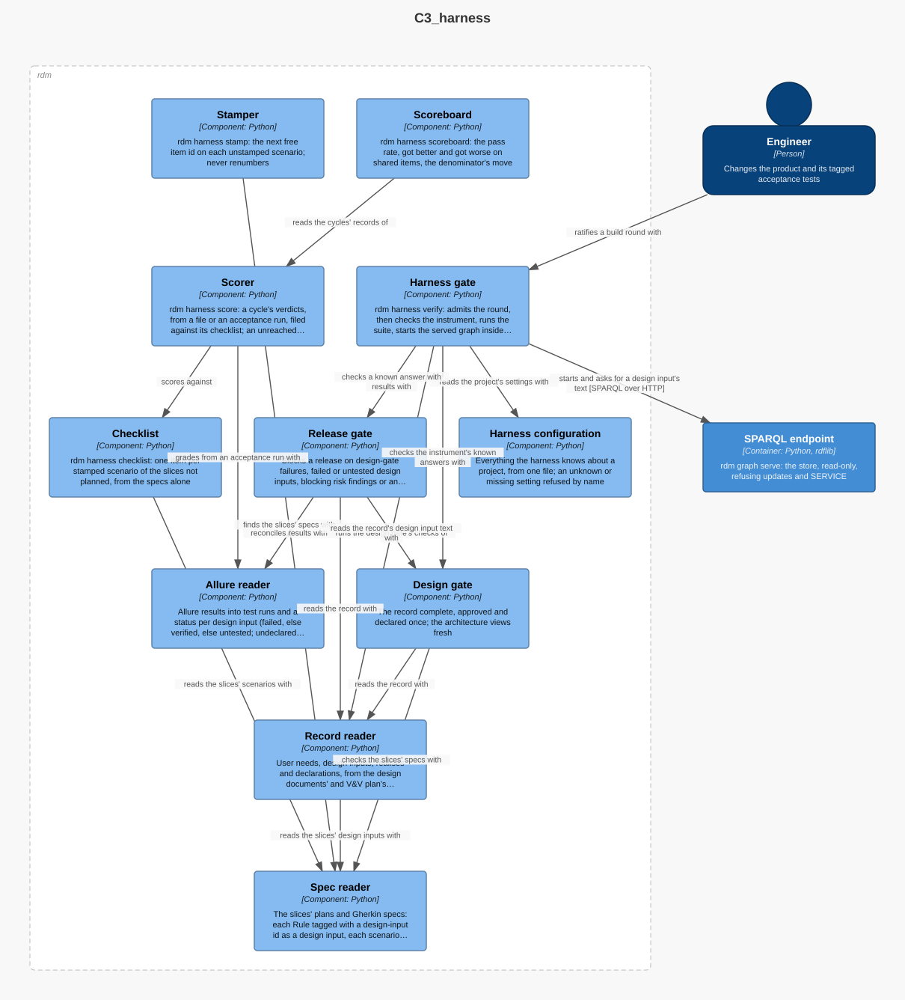

# Harness — Software Design

## Purpose

`harness` ratifies a build and measures the spec it was built from, after
Löyly's harness (`loyly/harness/`): it stamps every scenario of the slices'
specs with a stable item id, derives the checklist from the specs alone,
scores a cycle against it with honest denominators, compares cycles both
ways, and gates a build round: the round admitted (configuration and
spec-lock), the instrument checked against its known answers, the suite run
through the one command the project declares, the served graph started
inside a boot budget, and proved to serve this record. Its language
(`CONTEXT.md`): slice, spec, scenario, item id, checklist, cycle, ratify,
spec-lock. It is a program apart from RDM, written in Clojure and run by
babashka, as Löyly's is (slice 01, decision D10): `bb harness <command>` from
a project's root, its code under `harness/` and its tasks in `bb.edn`. It
imports nothing of RDM: it reads the slices' specs and an acceptance run's
results itself, and runs RDM's commands for the gates and the served graph.
Nothing reads it.

## Design Outputs

The design outputs are this context's components in the architecture
workspace, in the Harness container; the workspace maps each to its code
(`harness/src/harness/`).

| Component | Responsibility | Meets |
|-----------|----------------|-------|
| Harness configuration | Everything the harness knows about a project, from one EDN file (`harness/config.edn`), each setting documented; an unknown or missing setting refused by name; printed on every gate run | DI-100 |
| Stamper | Gives each unstamped scenario of a slice's spec the next free item id of its slice, on its own line above it at its indentation; never changes an id already there | DI-91 |
| Checklist | Derives the checklist (`harness/cycles/NN/checklist.json`) from the specs of the slices not `planned`, one item per stamped scenario with its slice, Rule and design input; refuses an unstamped scenario or an empty spec | DI-92 |
| Scorer | Files a cycle's verdicts, from a verdicts file or an acceptance run's results, against its checklist as the cycle's record (`harness/cycles/NN/score.json`); an item no verdict reached is a failure marked unreached | DI-93 |
| Scoreboard | Reads two cycles' records: the pass rate over every item, got-better and got-worse on the shared items, the denominator's move and the new items | DI-94 |
| Harness gate | `harness verify`: admits the round, then runs the chain of reactions (instrument, suite, served graph, identity) and concludes *Build Ratified* or *Build Not Ratified* | DI-95, DI-96, DI-97, DI-98, DI-99 |

Each command keeps RDM's handler shape (the release gate's, after the
PensionBee DDD workshop), in Clojure: read the state, derive the events with
a pure function, then apply only a success event (write the file) and report
every event. An event is a map of a name and a message; a name with a slash
is a fail event, *Warned* before the slash a warning, as in RDM's kernel. A
fail event exits 1 with its message on standard error; the harness never
writes on one.

**Reading a spec.** Line by line, as Löyly's tools do: a scenario is a line
whose first word is `Scenario:` or `Scenario Outline:`, its tags the tag
lines directly above it, its Rule the last `Rule:` line above it with that
Rule's own tag lines. RDM's spec reader parses the same file fully for the
record (DI-90); the two meet in the acceptance run, where each scenario's
result carries its item id and its Rule's design input.

**Stamper.** The slice number is the slice directory's name up to its first
`-`; the next running number is one past the highest the spec carries, with
at least three digits. Stamping is idempotent and never renumbers, so
rewording or reordering scenarios keeps the cycle-to-cycle join.

**Checklist and scorer.** Both are files in the cycle's directory, written
with sorted keys and two-space indentation, so the same specs give the same
bytes. Verdicts are `pass` or `fail` per item id; an acceptance run's
results grade a cycle by the item tag each scenario's result carries (a
passed result is a pass, a failed or broken one a failure, an item with no
result is unreached). Zero verdicts is *Cycle Not Scored / No Verdicts*,
never a cycle of failures.

**Harness gate.** Admitting the round concludes its independent rules
together: the configuration is read, a suite command is declared, and, with
`--base`, no slice's `plan.md` or `spec.feature` changed since that commit.
Then each step is a command a reaction issues on the previous step's success
event, so a failed step starts nothing after it (slice decision D9):

1. **Check instrument.** The design gate (and, where a known answer gives
   results, the release gate) is run on each of the configuration's known
   records, and each must get the verdict the configuration declares.
2. **Run suite.** The declared command runs from the project root; only its
   exit status counts.
3. **Start served graph.** The graph is built from the record into a
   temporary store and `rdm graph serve` is started on the configured port,
   refused if a process already listens there (named, never stopped). It
   must answer within the boot budget, polled at the configured interval;
   the poll it answered on is reported with the polls left. The clock covers
   the build and the start. Whatever it started is stopped before the gate
   returns.
4. **Prove identity.** The served graph is asked, by SPARQL, for the text of
   the record's first design input, and the answer must equal the text the
   record holds.

## Commands and events

| Actor | Command | Success event | Fail events | Entity |
|-------|---------|---------------|-------------|--------|
| Maintainer or agent | Stamp scenarios | Scenarios Stamped | Not Stamped / No Spec | Spec |
| Maintainer, agent or CI | Derive checklist | Checklist Derived (warned: Planned Slice Skipped) | Not Derived / Unstamped Scenario · Empty Spec | Checklist |
| Maintainer or CI | Score cycle | Cycle Scored | Not Scored / No Verdicts · Unknown Item | Cycle |
| Maintainer | Compare cycles | Cycles Compared | — | Scoreboard |
| Builder or CI | Admit round | Round Admitted | Not Admitted / Spec Changed · Unknown Setting · No Suite Declared | Build round |
| — (reaction) | Check instrument | Instrument Checked | Not Checked / Wrong Known Answer | Build round |
| — (reaction) | Run suite | Suite Passed | Not Passed / Suite Red | Build round |
| — (reaction) | Start served graph | Served Graph Answered | Not Started / Port Taken · Boot Budget Exceeded | Build round |
| — (reaction) | Prove identity | Identity Proven | Not Proven / Not This Record | Build round |

Reactions: whenever a round is admitted, the instrument is checked; whenever
it is checked, the suite runs; whenever the suite passes, the served graph is
started; whenever it answers, identity is proven. The verdict is *Build
Ratified* when *Identity Proven* happens, else *Build Not Ratified*.

## Dependencies

In the Gates part, outside RDM's package: the dependency rule's layers govern
imports, and the harness imports nothing of RDM. It runs `rdm story
design-gate` and `rdm story release-gate` on its known records, `rdm graph
build` and `rdm graph serve` for the served graph, and git for spec-lock, all
as commands, and asks the served graph over HTTP. It reads Allure result
files itself. Nothing depends on it.

## Out of scope

The fence (deleting the code and rebuilding it from the spec), carrying
Löyly's harness byte for byte, and a perception step (slice 01, decisions
D1, D4, D6).
