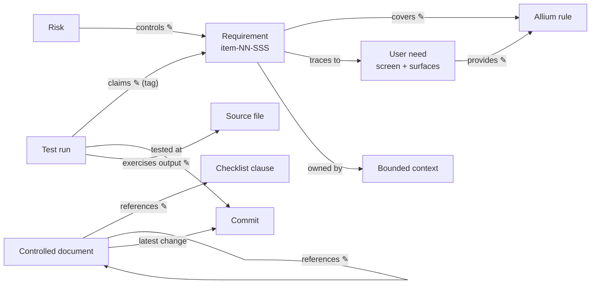
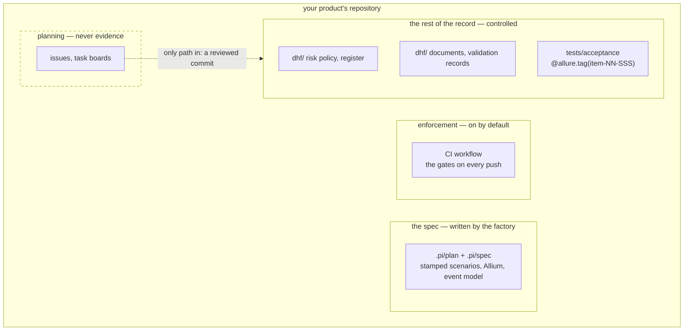

# How it works

## One idea

**RDM audits a record; it does not author it.** The spec is written,
stamped and regenerated by a factory such as
[Löyly](https://github.com/scope-impact/loyly). The rest of the record —
risks, checklists, controlled documents, validation records — is Markdown in
git. Test results and history are recorded by the tools that make them.
Everything RDM produces — gate verdicts, the graph, the rendered documents,
the traceability matrix, the release evidence bundle — is derived from them,
never edited by hand or fed back in.

The record changes only through review: the spec in the factory's own
process, the rest by a pull request that someone other than the author
approves; that review is the approval, and the merge records it. An agent
that wants to change the record opens a pull request, the same as a person.

| Written (the record) | Derived (by RDM) |
| --- | --- |
| the spec: stamped Gherkin scenarios, Allium surfaces and rules, the event model and storm (by the factory) | gate verdicts (release gate, gap analysis) |
| the risk policy and risk register | the RDF graph, its SHACL validation, the agent server's answers |
| checklists, and `[[KEY]]` references in documents | the traceability matrix and verification data |
| validation records of the user needs | rendered regulatory documents (PDF / DOCX) |
| acceptance tests tagged `@allure.tag("item-NN-SSS")` | the evidence bundle kept with a release |
| — | test results (Allure), recorded by running the tests |
| — | approval and change history, recorded by git and the forge |

The two rows without a written side are facts a tool records: what ran and
what passed, and who changed what, when. RDM reads them; nobody writes them.

## The data model

Every entity is declared **once**, in one place, with one id. Every link is
either **written** or **derived** by RDM; a fact that can be derived is never
also written, because two copies of one fact drift. The words are the
[glossary](../reference/glossary.md)'s.

✎ marks a written link; every other link is derived.

| Entity | Declared in | Id | Written there |
| --- | --- | --- | --- |
| **Bounded context** | a slice of the spec's plan, `.pi/plan/NN-<context>` | the context name | its spec, Allium and event model |
| **Requirement** | a stamped scenario of the context's `spec.feature` | `item-NN-SSS` | its title, its `Rule:`, the Allium obligations it covers (`@allium-…` tags) |
| **User need** | a screen of the event model, with the Allium surfaces it links; a surface, where a context has no screens | the screen's key (`alarms/ward-board`), or the surface's name | the actors, the rules provided, the guarantees, the commands and the storm events behind it |
| **Controlled document** | any Markdown file in the DHF with a frontmatter `id` | its `id` | `title`, `revision`, `references:` (documents it relies on), checklist references (`[[KEY]]`) |
| **Risk** | a `kind: risk` document, `risks:` | its `id` | hazard, situation, harm, category, scores, `controls:` (requirement ids), residual, acceptance |
| **Risk policy** | a document's `risk_policy:` | — | severities, probabilities, levels, acceptability |
| **Checklist, clause** | a checklist file (text or RDF) | the clause key, e.g. `62304:5.2.2` | each clause's description; includes |
| **Test run** | an Allure result, written by running the tests | its uuid | its `tag` labels `item-NN-SSS`, the requirements it claims; optionally `output` labels |
| **Commit** | git | its sha | nothing — it is recorded |

Derived, never declared:

| Fact | Derived from |
| --- | --- |
| a requirement's context | the slice whose `spec.feature` stamps it |
| the user needs a requirement addresses | the rules and guarantees it covers, else its context's needs |
| the commit a run tested | the `commit` label `rdm.pytest_plugin` writes at run time |
| a document's latest commit, and the commit that landed it | git history |
| whether a requirement is verified | the results of the runs that claim it |
| a risk's level and residual decision | its scores against the risk policy, and whether its controls are verified |
| the traceability matrix | requirements, user needs and test results |

How a change reaches the record: [Changing the record](../use/changing-the-record.md);
how the spec is laid out: [The spec and its tests](../use/spec-and-tests.md).

## An audited repository

`rdm adopt` lays down the record skeleton and the CI workflow without
touching existing files ([get started](../install/getting-started.md)). Planning tools stay
outside the record: [Plan vs. record](plan-vs-record.md).

## What RDM depends on

1. a git repository;
2. a spec in Löyly's layout (`.pi/plan`, or `spec:` in `dhf/config.yml`) and a
   design history file (`dhf/`);
3. Allure results from running the acceptance tests.

Nothing about how the work was planned, which tracker is used, or who (or
what) wrote the change. How RDM's own code is laid out, one package per
bounded context, is its [system architecture](../dhf/documents/architecture.md).
