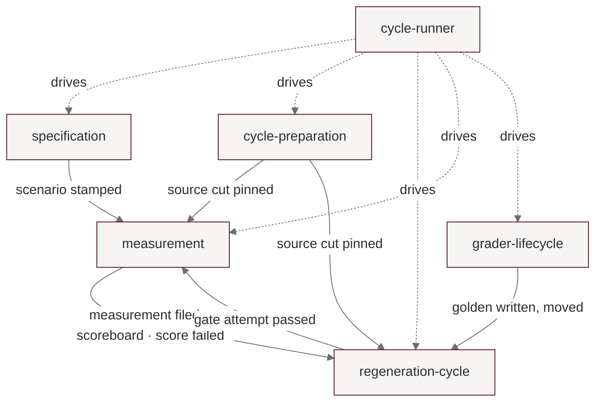

# Computer software validation — Löyly's pi harness

**Proposed, not yet approved.** The validation of Löyly's pi harness as a
tool, an agentic software factory that regenerates software from its spec,
and of the record system that keeps that validation (git, GitHub and RDM),
the computer software assurance way ([[13485:4.1.6-procedure]]). This is the
harness's final document: its intended use, architecture, risk analysis (the
risk policy and the risks are its frontmatter, which RDM's release gate
evaluates), its whole spec with each requirement's verification, the AI in
it, the assurance, the record and change. It is a template: `rdm render`
fills in the spec with the `include` and `glob` filters and the verification
from `data/verification.yml`; Part 11 is RDM's DC-001.

## Intended use

The pi harness takes a stamped, approved spec and a pinned source cut,
proves a clean room, has a builder regenerate the code from the spec alone,
gates the candidate, and grades it against the spec's checklist (for spec-v2,
by a grading agent). Its output, a regenerated candidate and its scoreboard, is used to
decide whether a regeneration of a product's software may proceed: it is
used directly in production of software, and its scoreboard is a quality
record ([[CSA:intended-use]], [[13485:7.5.6-software]]).

## Architecture

The pi harness is Löyly's regeneration harness: it stamps a spec, prepares a
cycle on a pinned source cut, fences a clean room, has a builder regenerate
the code from the spec alone, gates the candidate, and grades it against the
spec's checklist. Its requirements are the 201 stamped scenarios of Löyly's
spec v2; its user needs, the screens of each context's event model. Each
bounded context is one slice of Löyly's plan:

| Slice | Context | What it owns | Code |
|---|---|---|---|
| 01 | specification | stamping: an item identity per accepted scenario, never reused | `harness-impl/01-specification/` |
| 02 | measurement | the checklist of a source cut, item verdicts, scores and the scoreboard | `harness-impl/02-measurement/` |
| 03 | grader-lifecycle | instrument goldens, written from the scenario and moved only for a recorded reason | `harness-impl/03-grader-lifecycle/` |
| 04 | regeneration-cycle | the self-check, the fence and its clean room, the gate and its attempts | `harness-impl/04-regeneration-cycle/` |
| 05 | cycle-preparation | the pinned source cut | `harness-impl/05-cycle-preparation/` |
| 06 | cycle-runner | runs a cycle: launches the builder, waits, hands verdicts in | `harness-impl/06-cycle-runner/` |

The contexts meet only through the events each hands to another (each
context's `event-model/handoffs.edn`) and the seams its `seam.md` describes;
the cycle runner drives the other five through their seams:

The fence and the grader approval are where the architecture controls the
risks below. This record is kept from outside Löyly: the spec and the code
are RDM's `loyly` submodule, every acceptance suite runs unchanged, and the
evidence is their Allure results, each tied to the Löyly commit it tested.

## Process risk

A failure of the harness to perform as intended could let code that does not
meet its spec be accepted: a candidate scored on what it copied from a prior
one, a score from an unapproved grader, a requirement joined to the wrong
one across cycles, a golden moved to hide a failure. Where its output enters
a regulated product without independent verification, that compromises
product quality: **high process risk** ([[CSA:risk]]). The risks below are
evaluated against the risk policy below (a Low risk acceptable, a Medium or
High one only with a recorded acceptance, Block never), each control a
requirement of the harness's own spec where one exists. The analysis covers
every factor the guidance names (its §V.A(2)), for failures that are
reasonably foreseeable:

| Factor | Risks |
|---|---|
| Configuration and management | RISK-HAR-001 (a leaky clean room), RISK-HAR-005 (a claim lost by the bridge) |
| Security | RISK-HAR-004 (a golden moved to hide a failure), RISK-HAR-010 (prompt injection steers the builder) |
| Data integrity | RISK-HAR-002 (an unapproved grader), RISK-HAR-003 (a reused item identity), RISK-HAR-007 (the builder games the measure), RISK-HAR-008 (the grading agent misjudges) |
| Data storage, data transfer | the record system (below, and RDM's RISK-TOOL-009 and RISK-TOOL-010) |
| Operation error | RISK-HAR-006 (a commit other than the one validated), RISK-HAR-009 (the model changes under the same name) |

## Risk policy

## Risks

## Specification

The harness's spec, Löyly's spec v2, slice by slice: each accepted scenario,
stamped `@item-NN-SSS`, is a requirement, verified by the harness's own
acceptance suite through the bridge. The table is each requirement's
verification from the executed results; the feature files follow,
laid out by the `gherkin` render filter.


{{ verification.summary.verified }} of {{ verification.summary.total }} requirements verified ({{ verification.summary.failed }} failed, {{ verification.summary.untested }} untested), from {{ verification.summary.results_found }} executed test results.

| Requirement | Scenario | User need | Status |
|---|---|---|---|
| {{ req.requirement }} | {{ req.text }} | {{ group.user_need }} | {{ req.status }} |


The verification data is not part of this copy: run `run-acceptance.sh` and
`rdm story verify` (`dhf/data/verification.yml`), then render it again.



### {{ feature.split("/")[-2] }}

{{ feature | gherkin(verification | default(none)) }}



## AI in the harness

The harness drives two AI agents: the builder, which regenerates the code,
and, for spec-v2 cycles, the grading agent, which judges each item. Neither is
deterministic, so neither is what this validation validates: it validates
the deterministic harness around them, the clean room, the gate, the
checklist and the scoreboard, which every candidate and every verdict must
pass through. The guidance's risk framework applies to artificial
intelligence and machine learning tools used this way (its §V.A, printed
p. 6). The AI-specific risks are RISK-HAR-007 (the builder
games the measure), RISK-HAR-008 (the grading agent misjudges: no gate checks
its judgement, so human code review, spec review and an audit of the evidence
before release do), RISK-HAR-009 (the model
changes under the same name) and RISK-HAR-010 (prompt injection steers the
builder).

## Assurance activities

Proportionate to that risk ([[CSA:assurance]], [[13485:4.1.6-proportionate]]):

- **Scripted, automated testing.** Each of the 201 requirements of the
  harness's spec (stamped Given/When/Then scenarios) is verified by the
  harness's own acceptance suites, run unchanged; RDM traces every run to its
  requirement from the Allure results and blocks while any requirement lacks
  a passing run, any need is unaddressed, or any risk control is unverified.
- **Risk-based focus.** The requirements that control one of the risks
  (the fence, grader approval, item identities, golden moves) count only once
  verified and the risk's residual is evaluated again.
- **Unscripted assurance.** An operator runs a regeneration cycle through
  each user need and approves the result; each approval is a validation
  record in `dhf/validation/`, named for the need.
- **Ongoing monitoring.** Every cycle's scoreboard, compared with the last
  measured cycle, shows a regression the tests did not.

Beside its own tests, the assurance relies on what the harness keeps
itself ([[CSA:assurance-considerations]]): its event store and the run
evidence of each cycle, and Löyly's own review of the spec it is built from.

## Record

The record of each validation ([[CSA:record]], [[13485:4.1.6-records]]) is
the evidence bundle RDM writes from the run: the verification report (the
Löyly commit validated, who and what ran the tests and where, each
requirement with its runs, the issues found, and whether the evidence is
release-grade), the traceability matrix, the verification data and the
results themselves with a manifest and one SHA-256 over them. The conclusion
is the release gate's verdict; the approval, the reviewed pull request that
records it.

## The record system and Part 11

The validation record is required as evidence of a validated state and is
kept electronically, so it is a Part 11 electronic record and the system
that keeps it is held to Part 11 ([[CSA:part11]]). This record lives in
RDM's repository, so that system is RDM's own (git as the document control
system, GitHub as its service provider, RDM's gates), and RDM's Part 11
document, DC-001, maps its controls; its §11.10(a) validation is RDM's
CSV-001, done as this one is.

## Change

The harness is validated before first use and again after every change
([[13485:4.1.6-before-use]], [[CSA:change]], [[13485:7.5.6-software]]): a new Löyly commit is a change
to the `loyly` submodule, which reruns every suite and every gate in CI, and
the evidence is valid only for the commit it tested (a run of another commit
is stale evidence).
